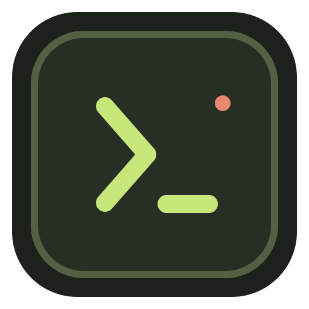
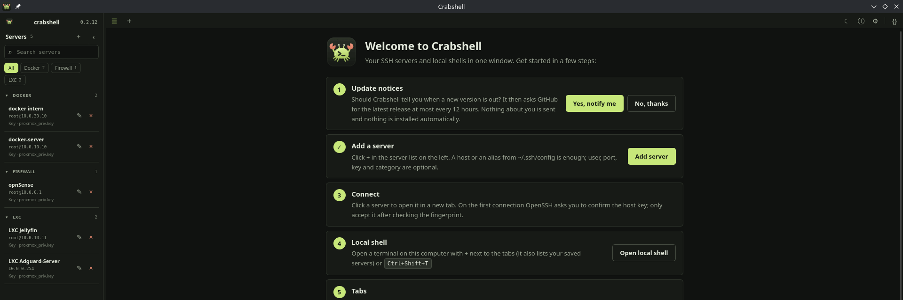

<div align="center">



# Crabshell

**A local SSH manager and terminal for Linux and Windows.**<br>
Tabs, saved servers, snippets and a clipboard that also works over SSH, built on the OpenSSH client you already have.

[](https://github.com/alex-1987/Crabshell/releases/latest)
[](https://github.com/alex-1987/Crabshell/releases)
[](#license)
[](#installation)
[](https://github.com/sponsors/alex-1987)

[**Download**](https://github.com/alex-1987/Crabshell/releases/latest) · [Installation](#installation) · [Features](#features) · [micro over SSH](#micro-over-ssh) · [Support the project](#support-the-project)

</div>

---

## Why Crabshell?

- 🔒 **Everything stays on your device.** No cloud, no account, no telemetry. Crabshell runs your system `ssh`, so your keys, `ssh-agent`, `known_hosts` and `~/.ssh/config` just keep working. The app never reads or copies private keys. Crabshell only connects to the internet on its own if you turn on update notices (off by default; one anonymous request to GitHub at most every 12 hours).
- 🗂️ **Your servers, one click away.** Save hosts with a label, user, port, key and their own color scheme, and open each one in its own tab.
- 🪟 **Two terminals side by side.** Split a tab left/right or top/bottom, or simply drag one tab onto another tab's terminal. Each half keeps its own session, and you can pull it back into its own tab at any time.
- 🧩 **Snippets for the commands you keep typing.** Search with `Ctrl+Shift+S` and paste into the active terminal. Nothing is ever sent without you pressing Enter, or `Ctrl+Enter` to paste and run.
- 📋 **Copy and paste that works over SSH.** Supports OSC 52, so micro, vim/Neovim and tmux on the server can use your local clipboard.
- 🎨 **Fits your desktop.** Light, dark or system theme, per-server designs, adjustable UI size, English and German.

> [!NOTE]
> **Crabshell is vibe-coded.** It was built largely through conversations with an AI coding assistant ([Claude Code](https://claude.com/claude-code)): I describe the features, test them, and decide what goes in. The code is checked with type checks, `clippy` and unit tests, but it has not had an independent security review. It is a hobby project, provided as is. Please read the code before trusting it with anything critical, and [open an issue](https://github.com/alex-1987/Crabshell/issues) if you find a problem.



## Installation

Crabshell needs the **OpenSSH client** (`ssh`). It is installed on almost every Linux system already, and the `.deb`, `.rpm` and Arch packages pull it in automatically.

### Which file do I need?

All files are on the [**latest release page**](https://github.com/alex-1987/Crabshell/releases/latest). Not sure which processor you have? Run `uname -m`: `x86_64` means Intel/AMD, `aarch64` means ARM (arm64).

| Your system | Intel/AMD (x86_64) | ARM (aarch64 / arm64) |
| --- | --- | --- |
| **Debian, Ubuntu, Linux Mint, Pop!_OS, elementary, Zorin** | `Crabshell_<version>_amd64.deb` | `Crabshell_<version>_arm64.deb` |
| **Fedora, openSUSE, RHEL/Alma/Rocky** | `Crabshell-<version>-1.x86_64.rpm` | `Crabshell-<version>-1.aarch64.rpm` |
| **Arch Linux, CachyOS, EndeavourOS, Manjaro, Garuda** | `crabshell-<version>-1-x86_64.pkg.tar.zst` | build it yourself ([see below](#building-it-yourself)) |
| **Anything else** | `Crabshell_<version>_amd64.AppImage` | `Crabshell_<version>_aarch64.AppImage` |
| **Windows 10/11** | `Crabshell_<version>_x64-setup.exe` (or `.msi`) | – |

The `.deb` and `.rpm` packages need glibc 2.35 or newer (Ubuntu 22.04, Debian 12, Fedora 36 or later). The Arch package is built against current Arch Linux.

### Quick install from the terminal

Each block below asks GitHub for the file of the latest release, downloads and installs it. You can paste a block as a whole. The commands work in bash, zsh and fish (3.4 or newer).

<details open>
<summary><b>Debian, Ubuntu, Linux Mint, Pop!_OS</b> (.deb)</summary>

```sh
curl -fLo crabshell.deb "$(curl -fsSL https://api.github.com/repos/alex-1987/Crabshell/releases/latest | grep -o "https://[^\"]*_$(dpkg --print-architecture)\.deb")"
sudo apt install ./crabshell.deb
```

The `./` in front of the file name matters: without it, `apt` searches its online repositories instead.

</details>

<details>
<summary><b>Fedora, RHEL, AlmaLinux, Rocky Linux</b> (.rpm)</summary>

```sh
curl -fLo crabshell.rpm "$(curl -fsSL https://api.github.com/repos/alex-1987/Crabshell/releases/latest | grep -o "https://[^\"]*\.$(uname -m)\.rpm")"
sudo dnf install ./crabshell.rpm
```

</details>

<details>
<summary><b>openSUSE</b> (.rpm)</summary>

```sh
curl -fLo crabshell.rpm "$(curl -fsSL https://api.github.com/repos/alex-1987/Crabshell/releases/latest | grep -o "https://[^\"]*\.$(uname -m)\.rpm")"
sudo zypper install --allow-unsigned-rpm ./crabshell.rpm
```

The package is not signed with a GPG key, so `zypper` needs `--allow-unsigned-rpm`.

</details>

<details>
<summary><b>Arch Linux, CachyOS, EndeavourOS, Manjaro, Garuda</b> (.pkg.tar.zst)</summary>

```sh
curl -fLo crabshell.pkg.tar.zst "$(curl -fsSL https://api.github.com/repos/alex-1987/Crabshell/releases/latest | grep -o 'https://[^"]*-x86_64\.pkg\.tar\.zst')"
sudo pacman -U ./crabshell.pkg.tar.zst
```

Download first, then install the local file: given a URL, `pacman -U` also looks for a GPG signature (`.sig`), which the packages do not have yet. The prebuilt package is for x86_64 only. On ARM, [build it with `makepkg`](#3a-arch-based-distributions-build-a-pacman-package).

</details>

<details>
<summary><b>Any other distribution</b> (AppImage, no installation)</summary>

```sh
curl -fLo Crabshell.AppImage "$(curl -fsSL https://api.github.com/repos/alex-1987/Crabshell/releases/latest | grep -o "https://[^\"]*_$(uname -m | sed s/x86_64/amd64/)\.AppImage")"
chmod +x Crabshell.AppImage
./Crabshell.AppImage
```

An AppImage is a single file you can put anywhere, for example in `~/Applications`. To get Crabshell into your application menu and the proper icon in the taskbar, open **⚙ Settings → Application menu and taskbar → Add to application menu** once (only shown when running the AppImage). If it refuses to start with a FUSE error, install `libfuse2` (`fuse2` on Arch, `fuse-libs` on Fedora), or run it with `--appimage-extract-and-run`.

</details>

<details>
<summary><b>Windows 10/11</b> (setup .exe)</summary>

1. Download `Crabshell_<version>_x64-setup.exe` from the [latest release](https://github.com/alex-1987/Crabshell/releases/latest) and run it. It installs for your user only, no administrator rights needed, and adds Crabshell to the Start menu.
2. The installer is **not code-signed** yet. If SmartScreen shows *"Windows protected your PC"*, click **More info → Run anyway**.
3. Crabshell uses the **OpenSSH client that ships with Windows 10/11**. If `ssh` is missing, add it under *Settings → System → Optional features → OpenSSH Client* (or run `Add-WindowsCapability -Online -Name OpenSSH.Client~~~~0.0.1.0` in an administrator PowerShell). Your keys and config live in `%USERPROFILE%\.ssh\` as usual.
4. Local tabs open **PowerShell** (PowerShell 7 `pwsh` when installed, otherwise Windows PowerShell).

Prefer an MSI (e.g. for deployment)? Use the `.msi` from the same release. Uninstall via *Settings → Apps*. Settings and servers are stored in `%APPDATA%\dev.crabshell.app\`.

</details>

### Install by clicking

1. Open the [latest release](https://github.com/alex-1987/Crabshell/releases/latest) and download the file for your system from **Assets** (see the table above).
2. **.deb / .rpm:** double-click the file. Your software center (GNOME Software, KDE Discover, ...) offers to install it.
   **AppImage:** right-click → *Properties* → *Permissions*, enable *Allow executing file as program*, then double-click it.
3. Start **Crabshell** from your application menu.

### Check the download (optional)

GitHub shows a `sha256:` checksum next to every file on the release page. Compare it with your download:

```bash
sha256sum Crabshell_*_amd64.deb     # use the name of the file you downloaded
```

If both values are identical, the file arrived unchanged.

### First steps

On the first start, the empty terminal area shows a short getting-started guide with the same steps (you can hide it there).

1. Click **+** in the server list on the left and enter the host (or an alias from `~/.ssh/config`). User, port and key are optional.
2. Click the server to open it in a new tab. On the first connection, OpenSSH asks you to confirm the server's host key in the terminal. Only accept it after you have checked the fingerprint.
3. Open **{}** (Snippets) in the tab bar to save commands you use often, and press `Ctrl+Shift+S` to search and paste them.
4. Use **⚙** to set the language, theme, click behavior, clipboard options and whether the last tabs reopen on start.

### Updating and uninstalling

To **update**, install the newer package the same way. Your servers, snippets and settings stay where they are.

| | Uninstall |
| --- | --- |
| Debian, Ubuntu, ... | `sudo apt remove crabshell` |
| Fedora, RHEL, ... | `sudo dnf remove crabshell` |
| openSUSE | `sudo zypper remove crabshell` |
| Arch, CachyOS, ... | `sudo pacman -R crabshell` |
| AppImage | delete the file |
| Windows | *Settings → Apps → Crabshell → Uninstall* |

Your data is not removed with the app. To delete it as well, remove `~/.config/dev.crabshell.app/` (Windows: `%APPDATA%\dev.crabshell.app\`).

## Features

### Servers and sessions
- Saved server profiles with label, category, host or `~/.ssh/config` alias, user, port (default 22) and private key. Port 22 is not passed to `ssh`, so a `Port` from `~/.ssh/config` still applies to aliases.
- Categories group the server list (collapsible). Click a category chip above the list to show only those servers; click it again to show all.
- Every tab has its own SSH session or local shell; its dot shows the status (connected, connecting, ended, error). Disconnect or reconnect from the tab's right-click menu or the message that appears in an ended terminal; switch tabs with `Ctrl+Tab`.
- Double-click a tab to rename it (e.g. "prod-db logs"). Enter saves, Escape cancels, an empty name goes back to the automatic title.
- Right-click a tab for its menu: rename, pick a tab color (quick colors, a custom color or back to the design's color) and close. Name and color are kept when the tabs reopen on start.
- Split view: show two terminals in one tab, side by side (`Ctrl+Shift+E`) or one above the other (`Ctrl+Shift+O`). The split buttons above the terminal let you choose what the new pane runs: the same server again, a local shell or another saved server. Drag the divider to resize (double-click resets it), switch the layout later, move between panes with a click or `Ctrl+Alt+Arrow`, and close a pane with its × or `Ctrl+Shift+W`.
- Drag tabs with the mouse: drop them on the tab strip to reorder, or onto the terminal of another tab to put both side by side. The edge you drop on (left, right, top, bottom) decides where it goes; hovering over a tab while dragging brings it to the front. ⇱ in a pane's header moves it back into its own tab. Sessions keep running while you rearrange them.
- `+` next to the tabs (or `Ctrl+Shift+N`) opens a new tab: choose a local shell, one of your saved servers (with a search field when you have many) or **New connection …**. That opens the server form with **Connect only**, which opens the tab without saving anything (such tabs are not restored on the next start), and **Save and connect**.
- **Test** in the server form checks a server without logging in: it resolves the host like OpenSSH (`ssh -G`, so `~/.ssh/config` aliases work), connects to the port and reads the SSH version line, e.g. "Reachable: 10.0.0.5:22 · OpenSSH_9.6 · 23 ms". Servers behind `ProxyJump`/`ProxyCommand` cannot be tested directly. `Ctrl+Shift+T` opens a local shell right away: your login shell (`$SHELL`) in your home directory, PowerShell on Windows.
- Optionally reopen the tabs from last time on start, or always start with an empty workspace.
- OpenSSH runs in a real PTY: full-screen programs, colors and resizing work as in any terminal.
- Closing the window while sessions are still running asks first ("3 sessions are still running"). Tick *Don't ask again* or turn it off in Settings. On close, every session is ended like in any other terminal (SIGHUP), so programs on the server stop unless they run in `tmux`, `screen` or with `nohup`.

### Snippets
- Saved commands with name and tags, in their own panel on the right: new, edit, duplicate, delete.
- Click a tag (in the chip row or on a snippet) to show only snippets with that tag.
- Search picker on `Ctrl+Shift+S`. `Enter` pastes, `Ctrl+Enter` (or ▶) pastes and runs.
- A snippet is only pasted into the active, connected terminal and never sent on its own. Trailing line breaks are removed, and multiline snippets always show a preview first.
- Snippets are stored unencrypted in `snippets.json`, so **do not put passwords in them**.

### Clipboard
- Selecting text copies it to the clipboard right away (on by default, can be turned off in Settings). `Ctrl+Shift+C` copies, `Ctrl+Shift+V` pastes. A confirmation for multiline paste is on as well (also for the context menu and middle click).
- Own right-click menu (copy, paste, select all, snippets) that also works in programs that take over the mouse, such as micro, htop or mc.
- In those programs, `Shift`+drag selects text. A setting lets plain dragging select as well.
- OSC 52: programs on the server can copy into your local clipboard. Reading your clipboard (e.g. `Ctrl+V` in micro) asks first and can be allowed per session.

### Look and layout
- Server list (left) and snippet panel (right) can each be shown, hidden and resized. If the window gets too narrow for both, the panel you opened last stays visible.
- Single or double click for opening servers and pasting snippets, set in Settings.
- Light, dark or system color scheme, and interface size 80–150 %.
- Per-server designs: text, background, cursor, selection and tab color, and font size, with a built-in color picker (hex input and quick colors).
- Fonts: pick the interface font and the terminal font from the fonts installed on your system (monospaced ones by default, Nerd Fonts included). `Ctrl+Plus` / `Ctrl+Minus` make the text of the current tab larger or smaller, `Ctrl+0` resets it.
- English and German. The language follows the system locale by default.
- Update notice: when a newer release is on GitHub, a dot appears on the ⓘ button, and ⓘ About shows "Version x.y.z available" with a link to the release page. Nothing is downloaded or installed automatically. The check is off until you turn it on: the welcome guide asks once, and ⚙ Settings → Updates has the switch and a "Check now" button. Hide the notice per version with ×.

### Shortcuts

These are the defaults. All terminal shortcuts can be changed under **⚙ Settings → Shortcuts**: click **+**, press the new combination, save. Each action can have up to four combinations or none at all. A shortcut needs Ctrl, Alt or Super (or an F key), and Crabshell warns before you take a key that terminal programs need, such as `Ctrl+C`.

| Shortcut | Action |
| --- | --- |
| `Ctrl+Shift+S` | Search and paste a snippet |
| `Ctrl+Shift+T` | New local shell |
| `Ctrl+Shift+N` | New tab: choose local shell or a saved server |
| `Ctrl+Shift+B` | Show or hide the server list |
| `Ctrl+Shift+E` / `Ctrl+Shift+O` | Split right / split down (same session) |
| `Ctrl+Alt+Arrow` | Move to the other pane |
| `Ctrl+Shift+W` | Close pane (or the tab when it is not split) |
| `Ctrl+Tab` / `Ctrl+Shift+Tab` | Next / previous tab |
| `Ctrl+Shift+C` / `Ctrl+Shift+V` | Copy / paste |
| `Ctrl+Plus` / `Ctrl+Minus` / `Ctrl+0` | Larger / smaller / reset text size of the current tab |

### Where your data lives

Everything is in `~/.config/dev.crabshell.app/` (Windows: `%APPDATA%\dev.crabshell.app\`), written atomically, so a crash never leaves a half-written file:

| File | Contents |
| --- | --- |
| `servers.json` | Server profiles (the key is stored as a path only, never its contents) |
| `settings.json` | Settings, designs and fonts |
| `snippets.json` | Snippets. An unreadable file is moved aside to `snippets.json.broken` instead of breaking the app. |
| `.window-state.json` | Window size, position, maximized and fullscreen (written by the Tauri window-state plugin) |
| `session.json` | Which tabs and split panes were open (tab type, server id, tab name and color only, never terminal contents) |

Not included yet: more than two panes per tab, SSH config import, snippet variables, snippet import/export and SFTP.

## micro over SSH

To copy and paste between your computer and [micro](https://micro-editor.github.io) running on a server, tell micro to use the terminal clipboard (OSC 52). On the **server**, put this into `~/.config/micro/settings.json`, or run `Ctrl+E` → `set clipboard terminal` in micro:

```json
{
    "clipboard": "terminal"
}
```

- **Copy:** select text in micro and press `Ctrl+C`. micro sends it to Crabshell, which puts it into your local clipboard. A short message in the terminal says "The program copied text to the clipboard."
- **Paste with `Ctrl+V` in micro:** micro asks Crabshell for the local clipboard. The first time per session, Crabshell asks whether the server may read it (*Deny* or *Allow for this session*). micro only waits 200 ms for the answer, which is too short for the dialog, so press `Ctrl+V` **once more** after allowing it. From then on, `Ctrl+V` works straight away until you disconnect.
- **Paste with `Ctrl+Shift+V`** (or right-click → Paste) always works and never gives the server access to your clipboard.

Without `"clipboard": "terminal"`, micro uses its own clipboard on the server (or `xclip`/`wl-copy` there), which cannot reach your computer. Both directions, writing and reading the clipboard, can be changed under Settings → Clipboard. For reading, the options are *Ask*, *Always* or *Never*. Only allow reading for servers you trust, because the server receives whatever you copied, including passwords.

`Shift`+drag selects text even while micro uses the mouse, but it copies micro's line numbers too. Use micro's own selection with `Ctrl+C` instead, or turn the ruler off with `set ruler off`.

## Support the project

<div align="center">

**Crabshell is free and open source. If it saves you time, please consider supporting it.** ♥

[](https://github.com/sponsors/alex-1987)

</div>

A one-time or monthly contribution via [GitHub Sponsors](https://github.com/sponsors/alex-1987) helps me keep improving Crabshell: new features, more packages, and keeping up with new distributions. The button is also in the app under **ⓘ About**. Crabshell only opens the page in your browser and never handles payment data.

No budget? Starring the repository ⭐, [reporting bugs](https://github.com/alex-1987/Crabshell/issues) and telling others about it helps too.

## Building it yourself

<details>
<summary><b>Show build instructions</b></summary>

### 1. Install the build dependencies

You need Rust (via [rustup](https://rustup.rs) or your distribution's package), Node.js 20 or newer with npm, the WebKitGTK 4.1 development files and the OpenSSH client.

**Arch Linux, CachyOS, EndeavourOS, Manjaro**

```bash
sudo pacman -S --needed base-devel git rust nodejs npm webkit2gtk-4.1 gtk3 librsvg openssh
```

**Debian 12+, Ubuntu 22.04+, Linux Mint, Pop!_OS**

```bash
sudo apt install build-essential curl wget file git libwebkit2gtk-4.1-dev libxdo-dev libssl-dev \
  libayatana-appindicator3-dev librsvg2-dev openssh-client nodejs npm
curl --proto '=https' --tlsv1.2 -sSf https://sh.rustup.rs | sh   # if Rust is not installed yet
```

The `nodejs` package in older Ubuntu releases may be too old. In that case, install Node.js LTS from [nodejs.org](https://nodejs.org) or via `nvm`.

**Fedora**

```bash
sudo dnf install webkit2gtk4.1-devel openssl-devel curl wget file git libxdo-devel \
  libappindicator-gtk3-devel librsvg2-devel openssh-clients nodejs npm rust cargo
sudo dnf group install c-development
```

For other distributions, see the [Tauri prerequisites](https://v2.tauri.app/start/prerequisites/#linux).

### 2. Get the source

```bash
git clone https://github.com/alex-1987/Crabshell.git
cd Crabshell
npm ci
```

### 3a. Arch-based distributions: build a pacman package

```bash
cd packaging/arch
makepkg -si        # builds, runs the tests and installs the package
```

The package is built from your local checkout, so local changes are included. The version comes from `src-tauri/tauri.conf.json`.

### 3b. Other distributions: build .deb, .rpm and AppImage

```bash
npm run tauri build                              # all formats from tauri.conf.json
npm run tauri build -- --bundles deb             # only one format (deb, rpm or appimage)
npm run tauri build -- --no-bundle               # only the binary: src-tauri/target/release/crabshell
```

The packages end up in `src-tauri/target/release/bundle/` (`deb/`, `rpm/`, `appimage/`). Install them as described under [Installation](#installation).

If the AppImage step fails while stripping libraries (common on very new distributions such as Arch), retry with `NO_STRIP=true npm run tauri build -- --bundles appimage`, or use a native package instead.

</details>

## Development

<details>
<summary><b>Run, check and release</b></summary>

### Run in development mode

```bash
npm install
npm run tauri dev
```

### Checks

```bash
npm run build
cd src-tauri && cargo fmt --check && cargo clippy --all-targets --all-features -- -D warnings && cargo check && cargo test
SHELL=/bin/sh cargo test -- --ignored   # additionally spawns a real local shell (run inside src-tauri)
```

### UI tests (Linux)

`scripts/e2e/` drives the real app through [tauri-driver](https://v2.tauri.app/develop/tests/webdriver/) and WebKitWebDriver: open a shell, rename a tab, pick a tab color and so on. The app runs with an empty temporary config directory, so your own servers and settings stay untouched; a Crabshell window opens briefly while the tests run.

```bash
cargo install tauri-driver --locked   # once; WebKitWebDriver ships with webkit2gtk (Arch) or webkit2gtk-driver (Debian/Fedora)
npm run test:e2e                      # builds a debug app and runs the checks
```

### Releases

Pushing a tag such as `v0.2.1` builds the `.deb`, `.rpm` and AppImage packages on Ubuntu 22.04 for x86_64 and arm64, the Windows installer (`-setup.exe` and `.msi`), and the pacman package in an Arch Linux container. Before anything is built, a test job runs the TypeScript check and build, `cargo fmt --check`, clippy and the Rust tests. The packages are attached to a draft release for that tag, and a final job publishes it automatically once the tests and every build have succeeded. If anything fails, the release stays a draft for you to check.

The version is taken from the tag (`v0.2.1` → `0.2.1`). A suffix such as `v0.3.0-beta.1` marks the release as a pre-release. You do not have to bump the version numbers in the repository first. To keep them in sync locally anyway, run `node scripts/set-version.mjs 0.2.1`, which updates `package.json`, `package-lock.json`, `src-tauri/tauri.conf.json`, `src-tauri/Cargo.toml` and `src-tauri/Cargo.lock`. Starting the workflow manually without a tag uses the version from `src-tauri/tauri.conf.json`.

```sh
git push origin main
git tag v0.2.1
git push origin v0.2.1
```

### Project layout

| Path | What lives there |
| --- | --- |
| `src/TabsApp.tsx` | App shell: loads data, wires panels, tabs and dialogs together |
| `src/terminalStore.ts` | Tabs, panes, xterm.js instances, sessions, clipboard and shortcuts (outside React) |
| `src/ServerSidebar.tsx`, `src/ServerList.tsx`, `src/ServerDialog.tsx` | Server list, search, categories, add/edit dialog |
| `src/SnippetPanel.tsx`, `src/SnippetSidebar.tsx`, `src/SnippetPicker.tsx`, `src/SnippetEditor.tsx`, `src/useSnippets.ts` | Snippets |
| `src/TerminalTabPanel.tsx`, `src/SplitView.tsx`, `src/SplitMenu.tsx`, `src/useTabDrag.tsx` | Terminal area, split view, tab drag and drop |
| `src/SettingsDialog.tsx`, `src/ShortcutList.tsx`, `src/ColorField.tsx` | Settings, shortcut editor, color picker |
| `src/Dialog.tsx`, `src/ConfirmDialogs.tsx` | Shared dialog frame; paste, clipboard and close confirmations |
| `src/usePanelLayout.ts`, `src/persistence.ts`, `src/labels.ts`, `src/osc52.ts` | Panel sizes, session/migration helpers, display texts, OSC 52 |
| `src-tauri/src/sessions.rs`, `src-tauri/src/session.rs` | Running sessions and their commands; PTY, `ssh` and shell startup |
| `src-tauri/src/storage.rs`, `src-tauri/src/snippets.rs` | Validated JSON files in the config directory |
| `src-tauri/src/desktop.rs` | AppImage menu entry and icons |

### Notes for contributors

- **Translations:** UI texts live in `src/i18n.ts`. English is the reference dictionary, and other languages must define the same keys (TypeScript reports missing ones). Error messages from the Rust backend stay in English and are translated in the `backendMessages` table there.
- **UI colors** live in `src/theme.css`: about 15 named colors (`--bg`, `--surface`, `--border`, `--text`, `--accent`, …), once for the dark and once for the light scheme. Use these variables in `src/styles.css` instead of new color values.

</details>

## License

Crabshell is dual-licensed under either of

- [MIT License](LICENSE-MIT)
- [Apache License, Version 2.0](LICENSE-APACHE)

at your option.

Unless you explicitly state otherwise, any contribution you intentionally submit for inclusion in Crabshell, as defined in the Apache-2.0 license, is dual-licensed as above, without any additional terms or conditions.
